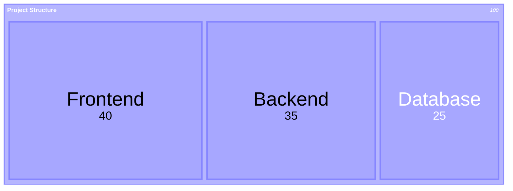
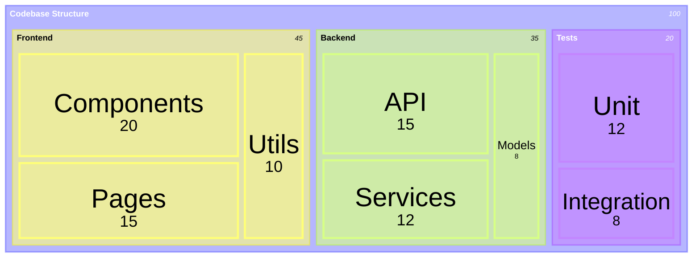
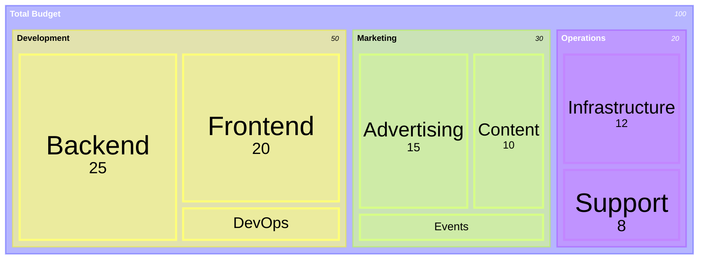

Treemaps visualize hierarchical data as nested rectangles, with size proportional to value. Perfect for showing proportions, file sizes, and hierarchical structures.

## Use Case

Use treemaps when you need to:
- Show hierarchical proportions
- Visualize file/directory sizes
- Display category breakdowns
- Show nested data structures
- Compare relative sizes

## Code

````markdown

````

**Result:**


## Examples

### Example 1: Project Structure

````markdown

````

**Result:**


### Example 2: Budget Allocation

````markdown

````

**Result:**


## Notes

- Keyword is `treemap-beta` (Mermaid 11.8.0+)
- Every label is double-quoted; leaves are `"Label": value`
- Indentation creates hierarchy; parents carry no value (their size is the sum of children)
- Can nest multiple levels

## Gotchas/Warnings

- ⚠️ **Indentation**: Must be consistent for hierarchy
- ⚠️ **Values**: Only on leaves, positive numbers
- ⚠️ **Nesting**: Can nest multiple levels deep
- ⚠️ **Proportions**: Rectangle sizes proportional to values


